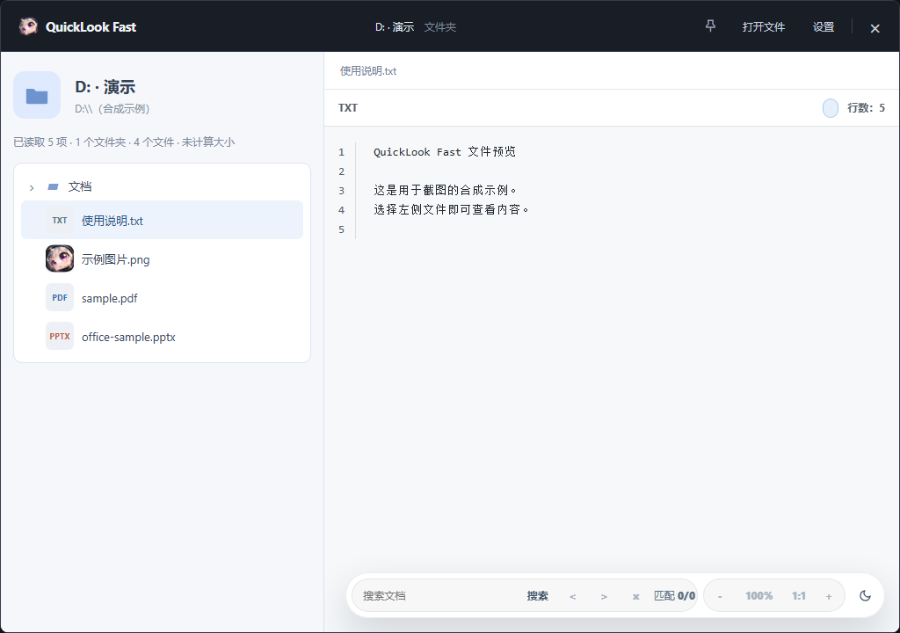
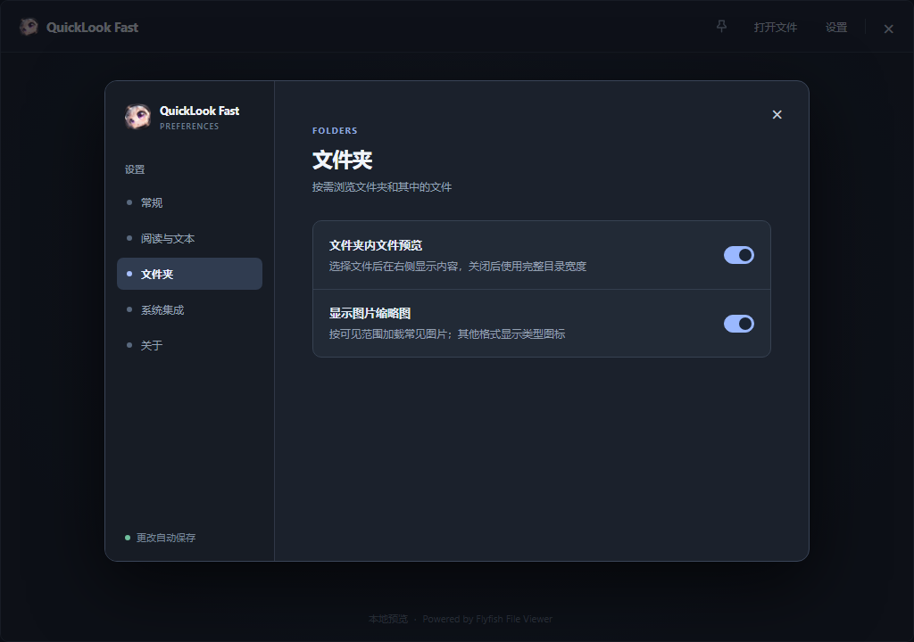

# QuickLook Fast


QuickLook Fast 是离线优先的桌面文件预览工具。选中文件后，通过文件管理器入口快速查看内容；关闭预览后程序继续驻留在系统托盘。项目原名 SlowLook，使用 Electron、TypeScript 和 [Flyfish File Viewer](https://github.com/flyfish-dev/file-viewer) 构建。

当前版本为 **0.2.0**。不同系统的快捷键接入、文件格式和文档还原效果存在差异；支持范围不等于所有文件都已完成实机验证。

## 目录

- [界面截图](#界面截图)
- [下载与运行](#下载与运行)
- [基本操作](#基本操作)
- [预览能力与限制](#预览能力与限制)
- [平台与文件管理器](#平台与文件管理器)
- [开发与构建](#开发与构建)
- [项目目录](#项目目录)
- [故障排查](#故障排查)
- [文档与许可证](#文档与许可证)

## 界面截图

以下图片使用合成文件夹、合成 PDF 与公开 PPTX 示例。来源与重建方法见[打包与维护](docs/releasing.md#重建文档截图)。

<!-- screenshots:start -->

**文件夹与内容预览**



**PDF 预览**


**PPTX 预览**


**设置**



**欢迎页**


<!-- screenshots:end -->

## 下载与运行

从 [GitHub Releases](https://github.com/Chaoleme-Studio/quick_look_fast/releases) 下载对应系统和架构的归档，**完整解压整个目录**后运行；可执行文件需要与其余程序文件保持在一起。

| 平台 | 目标环境 | 启动入口 | 当前限制 |
| --- | --- | --- | --- |
| Windows | Windows 10/11，x64 | `QuickLook Fast.exe` | Explorer、桌面和 Directory Opus 接入仍需实机验证；发布包未签名。 |
| macOS | macOS 26 及以上，Apple Silicon / arm64 | `QuickLook Fast.app` | Finder 使用可选组合键；仅临时签名，未进行 Apple 公证。 |
| Linux | x64，GNOME / KDE Plasma 等 | `./quicklook-fast` | 使用 GNOME 预览服务或 Dolphin/Nemo 菜单，需满足 Electron 系统依赖。 |

本地开发构建位于 `build/versions/V17/` 这样逐个编号的目录中，编号是**本地构建迭代号**，与软件版本 `0.2.0` 分开。新构建不会覆盖已有编号。

## 基本操作

1. 启动程序；在 Windows 中，程序会在系统托盘常驻。
2. 在已接入的文件管理器中选中文件，按 **Space** 打开预览；再按 Space 或 **Esc** 收起。
3. 使用方向键尝试跟随文件管理器的选择；点击图钉固定当前窗口，可以继续预览其他文件。
4. 关闭预览窗口只会隐藏窗口；从托盘菜单选择“退出”才能结束程序。

也可以从窗口选择文件、拖放文件，或向程序传入完整路径。在“设置 → 关于”可手动检查 Release 更新；下载和替换需要自行完成。

## 预览能力与限制

| 类型 | 支持情况 | 主要边界 |
| --- | --- | --- |
| 文档 | PDF、DOCX、XLSX、PPTX、OFD 等使用 Flyfish；支持常见密码加密的 OOXML。 | 复杂排版可能不同于原软件；加密 Office 输入与输出各限 64 MiB。 |
| 图片和媒体 | 图片预览显示宽高，信息按钮读取照片 EXIF。支持图片缩放、音视频播放和可拖动的音频波形。 | 尺寸取决于解码或文件头，EXIF 取决于原图是否保留拍摄参数。较长或较大的音频显示示意波形。 |
| 代码与文本 | 代码着色、行号、Markdown 目录和文档目录内的相对图片；字幕可按文本查看。 | 超过 16 MiB 的常见文本默认只读取开头 1 MiB；本地图片限常见栅格格式、每张 12 MiB。 |
| 文件夹和压缩包 | 文件夹分页和下钻，ZIP/RAR 按需读取目录及所选内容，支持常见密码。 | 文件夹总大小不递归统计；压缩包单条目压缩与解压后各限 64 MiB。 |
| HTML、工程和其他格式 | 本地 HTML 可切换脚本；CAD、3D、设计、邮件及数据文件由对应渲染器尝试打开。 | HTML 脚本默认开启，可在设置中关闭；复杂格式、网络资源与受保护内容不保证完整显示。 |

Flyfish 3.3.4 上游登记了 275 个扩展名；本项目当前约 266 个扩展名进入内容渲染候选。这是代码路由统计，不是逐一实测通过的数量。详细能力、大小限制和验证状态见[兼容性说明](docs/compatibility.md)及[使用指南](docs/user-guide.md)。

预览默认在本机进行。HTML 使用隔离框架，HTTP(S)/WebSocket 外联受到限制；这不等于完整的安全隔离。手动检查更新时会连接 GitHub，不上传预览文件。

## 平台与文件管理器

- **Windows**：Explorer、桌面和 Directory Opus 支持已实现的 Space 入口。与 QuickLook、PowerToys Peek 或 DOpus 自带快捷键同时运行时可能冲突。
- **macOS**：Finder 使用可选的 `⌘ Shift Space` 实验入口；系统原生 Space 尚未接管，可能需要自动化权限。
- **Linux**：解压后运行 `./install-integration.sh` 安装 Dolphin/Nemo 菜单；增加 `--gnome` 同时安装 GNOME Files 预览服务。Dolphin 26.04 及以上可尝试为服务菜单设置 Space。

切换自旧 QuickLook 或 SlowLook 时，先退出旧程序并关闭其开机启动。旧设置和插件不会自动迁移。系统权限、Wayland/X11、Finder 和 DOpus 双栏等细节见[平台说明](docs/platforms.md)。

## 开发与构建

需要 Node.js 24 和项目指定版本的 pnpm。Windows 构建原生桥接还需要 .NET Framework C# 编译器；安装依赖和下载 Electron 运行时需要网络。

```sh
pnpm install --frozen-lockfile
pnpm run electron:install
pnpm run build
pnpm test
pnpm run dev
```

Windows 本地生成便携版：

```sh
pnpm run dist:win
```

也可在构建后指定尚不存在的编号，例如 `node scripts/pack-portable.cjs V13`。不指定编号时自动选择现有最大编号的下一个；已有目录不会被覆盖。完整打包及其他平台说明见[打包发布](docs/releasing.md)。

`pnpm run screenshots` 重新生成文档截图；`pnpm run benchmark:file` 运行文件服务基准。自动化测试与真实桌面交互覆盖范围不同，实际验收项目见[需求与验证](docs/requirements-and-verification.md)。

## 项目目录

```text
.
├── src/                 预览界面、Vite 入口和样式
│   ├── preview/         图片、媒体、目录、文本、网页、压缩包
│   └── ui/              文件信息、侧栏按钮、密码输入
├── electron/            主进程和 preload
│   ├── files/           文件服务、目录会话和解析 Worker
│   ├── platform/        系统接入，含 Linux 预览及安装入口
│   └── support/         更新与诊断
├── native/              Windows 桥接源码
├── public/              应用图标等静态资源
├── docs/                使用、架构、发布文档与第三方许可原文
├── patch/               Flyfish 的 DOCX、PPTX、XLSX 补丁
├── scripts/             原生构建、便携打包和本地文件服务基准
├── tests/               自动化测试和公开测试样本
├── tools/               截图和图标工具
├── build/               本地生成物，不提交
│   ├── dist/            前端编译结果
│   ├── dist-electron/   主进程与 preload 编译结果
│   ├── native/          Windows 原生编译结果
│   └── versions/        V13、V14 等独立便携版本
└── .local/              本地缓存、调研副本与历史构建，不打包、不提交
```

`src/index.html` 是 Vite 的源码入口。Electron 启动时使用构建生成的 `build/dist/index.html`。`node_modules/`、`build/` 和 `.local/` 只在本机使用。第三方许可原文位于 `docs/licenses/`。

## 故障排查

- **Space 没有反应**：确认程序在托盘运行，检查 QuickLook、Peek 或文件管理器快捷键是否冲突，并查看“设置 → 系统集成”。
- **文档显示不完整**：先检查文件是否加密、超出大小限制，或依赖未安装字体；复杂文档可对照[兼容性说明](docs/compatibility.md)。
- **程序异常退出**：在“设置 → 关于 → 运行诊断”打开本地状态日志。Windows 原生异常可能没有日志；需要复现时可按[诊断说明](docs/user-guide.md#本地崩溃诊断)选择启用本地崩溃转储。

诊断日志只记录时间和进程状态，不上传文件内容。可选转储可能包含内存中的文件内容或路径，分享前请自行确认。

## 文档与许可证

- [使用指南](docs/user-guide.md) · [架构与性能](docs/architecture.md) · [兼容性](docs/compatibility.md)
- [平台接入](docs/platforms.md) · [需求与验证](docs/requirements-and-verification.md) · [打包发布](docs/releasing.md)
- [参考项目](docs/references.md) · [第三方组件和许可](THIRD_PARTY.md)

本项目自有代码采用 [Apache-2.0](LICENSE)。第三方组件分别适用各自许可证；Flyfish 的部分 CAD 运行时包含 AGPL/GPL 组件，详情及对应源码位置见[第三方说明](THIRD_PARTY.md)。感谢 Flyfish 团队及所有开源贡献者。

组织：[Chaoleme Studio](https://www.chaoleme.cn/) · 社区：[Linux DO](https://linux.do/)
