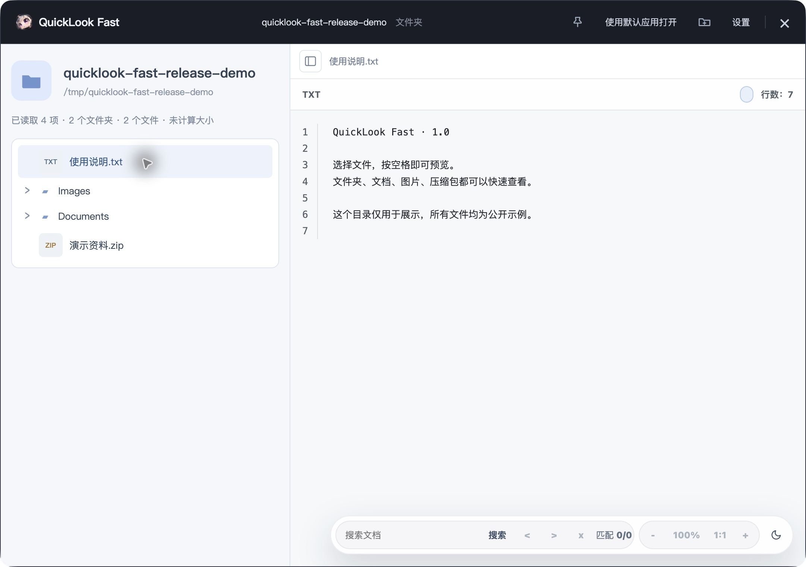
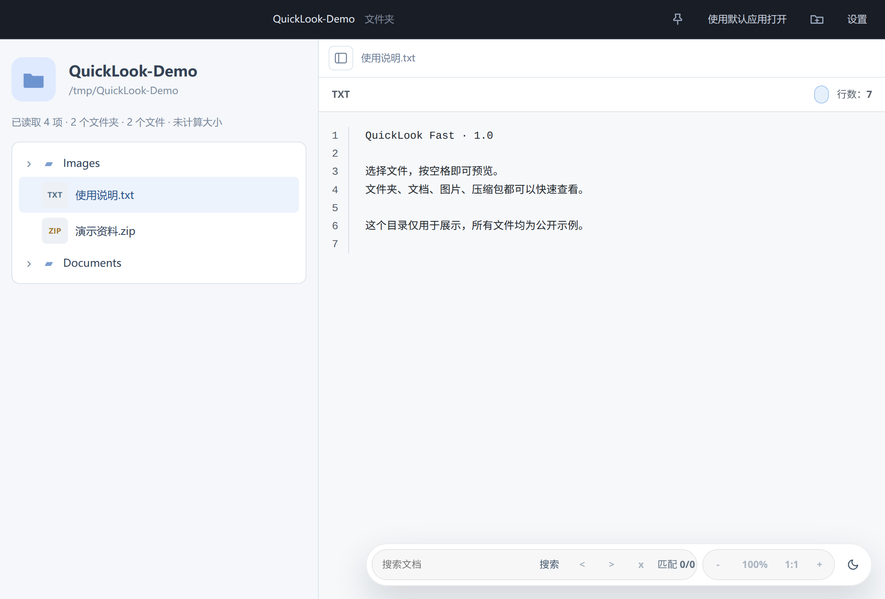
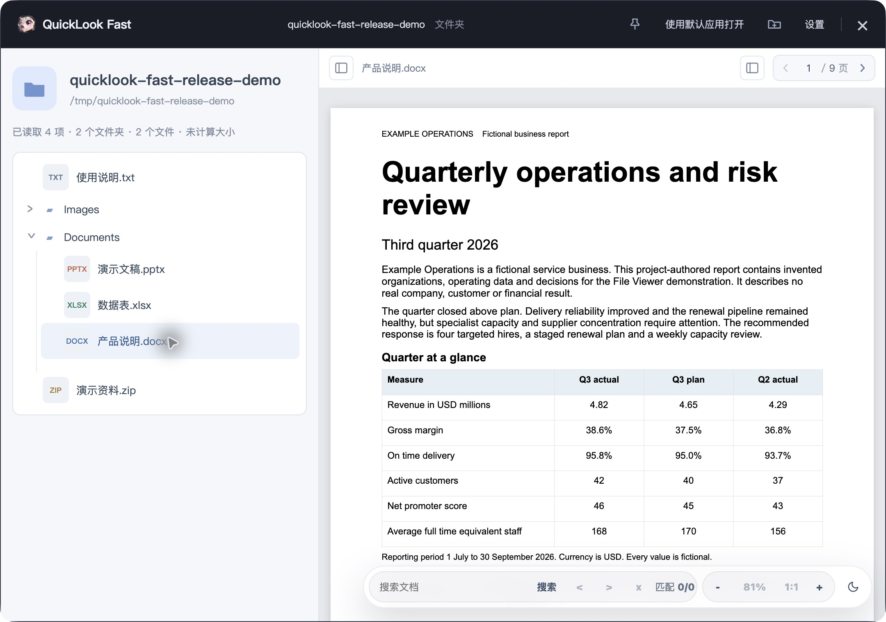
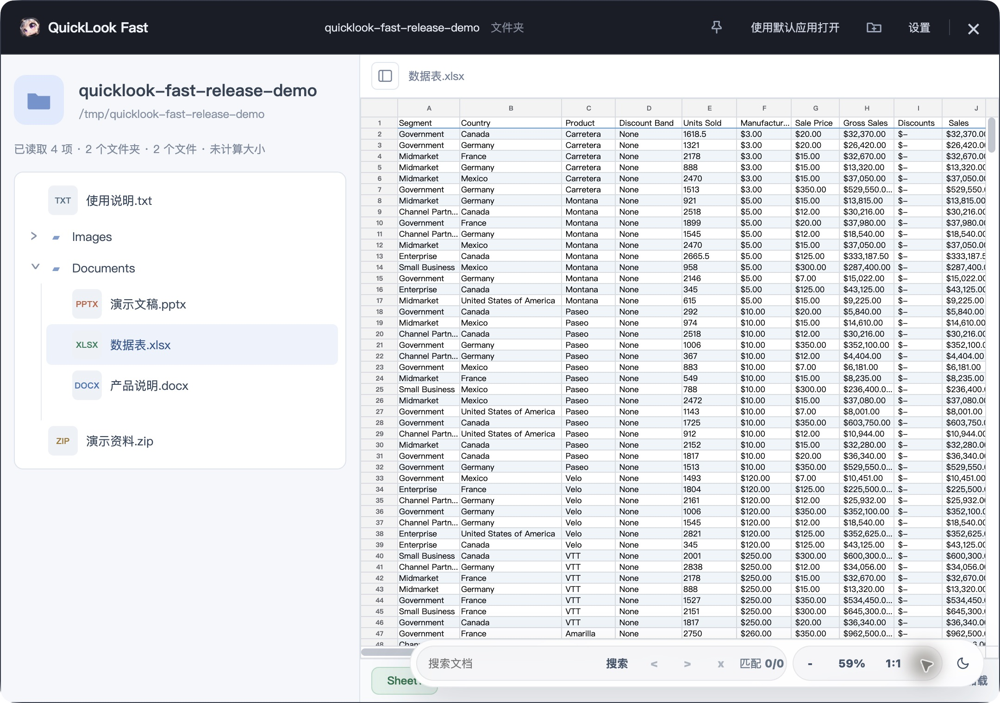
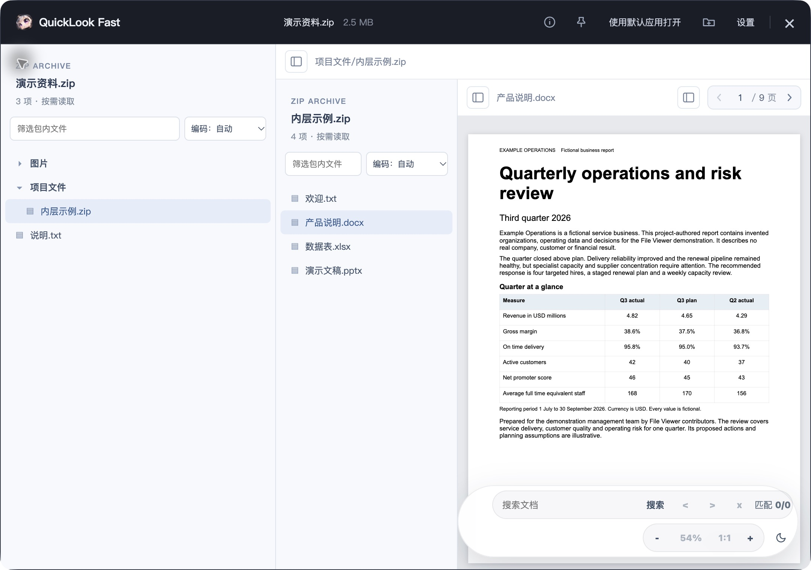
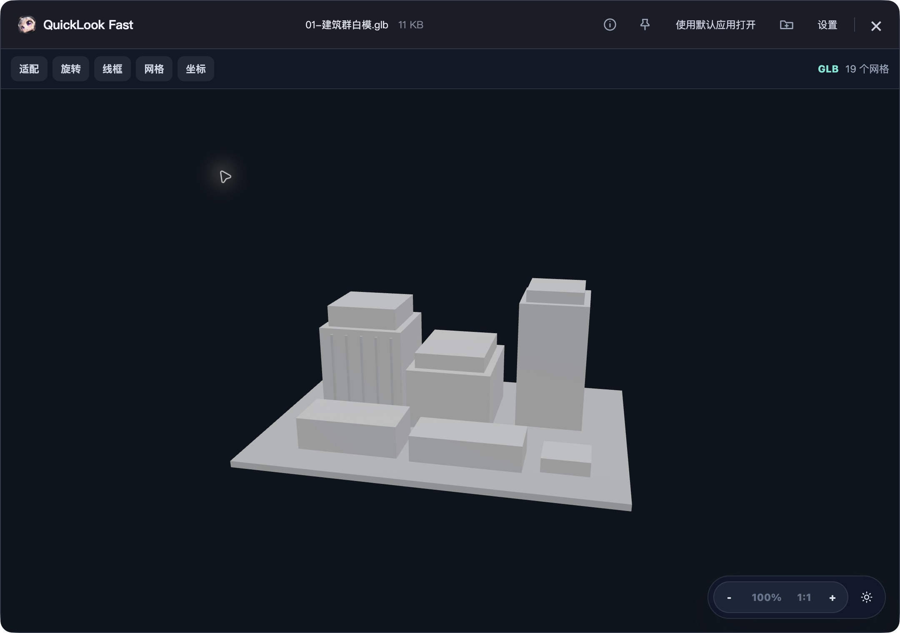
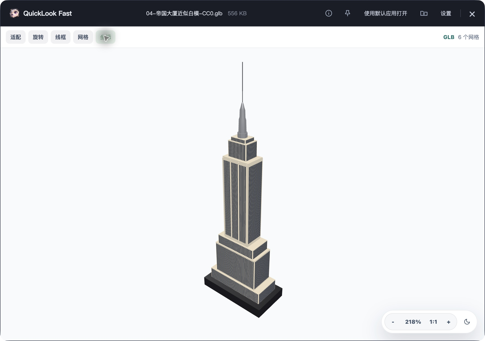
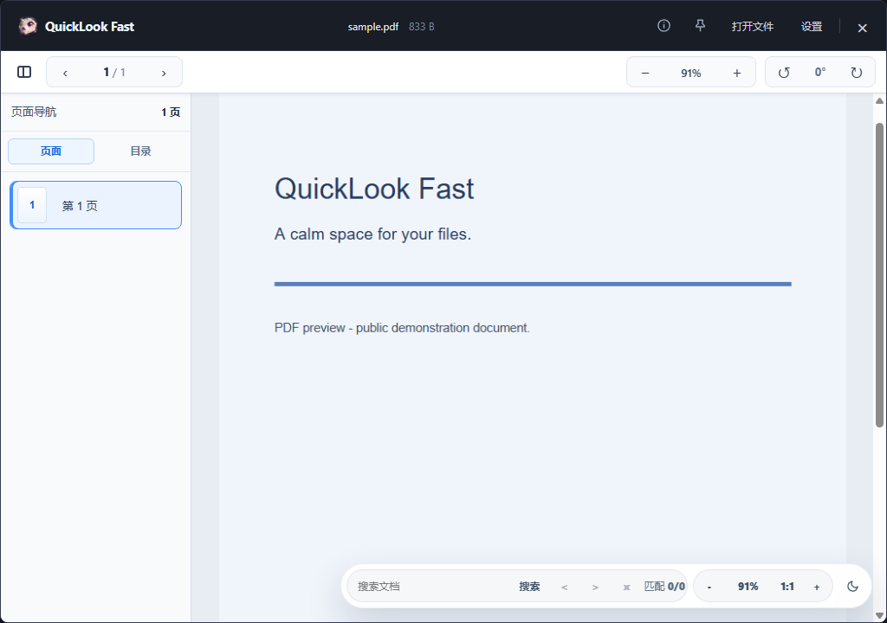

# QuickLook Fast


QuickLook Fast 是离线优先的跨平台文件预览工具。完成系统接入后，选中文件或文件夹，按空格查看内容，再按一次收起；也可以从窗口选择文件或直接拖放。项目使用 Electron、TypeScript 和 [Flyfish File Viewer](https://github.com/flyfish-dev/file-viewer) 构建，支持 Windows、macOS 和 Linux。

不同系统的快捷键接入、文件格式和文档还原效果存在差异；支持范围不等于所有文件都已完成实机验证。

## 功能亮点

- **空格预览**：在支持的文件管理器或桌面中选中项目，按 Space 打开、再次按 Space 收起。即使点击了按钮或设置开关，默认仍可用空格关闭预览；这一行为可以在设置中关闭。
- **文件夹和压缩包**：按层级浏览目录，选中文件在旁边直接预览；ZIP/RAR 支持查看目录及按需打开条目，ZIP 中的 ZIP 可继续浏览。可隐藏 `.DS_Store` 和 `__MACOSX`，只改变预览列表，不修改原文件。
- **文档与表格**：查看 Word、Excel、PPT、PDF 等内容；Word 和 PPTX 支持预览翻页，Word 还可按标题导航。复杂字体、图表、动画或排版可能与原程序不同。
- **图片、媒体和更多格式**：支持图片缩放、旋转和信息查看，音视频播放，以及代码、Markdown、3D、CAD、设计文件等内容或结构预览。[完整格式和边界](docs/formats.md)。
- **按自己的习惯使用**：固定预览窗口、调整文本行号和换行、切换文档导航与页码、控制缩略图及自动播放。macOS 可分别控制 Dock、菜单栏图标与 Finder 快捷键。
- **本地优先**：预览在本机进行；打开“设置 → 关于”时会联网检查更新，不上传预览文件。

## 目录

- [功能亮点](#功能亮点)
- [界面截图](#界面截图)
- [下载与运行](#下载与运行)
- [基本操作](#基本操作)
- [预览能力与限制](#预览能力与限制)
- [完整格式清单](docs/formats.md)
- [平台与文件管理器](#平台与文件管理器)
- [技术方案](#技术方案)
- [兼容性补丁](#兼容性补丁)
- [开发与构建](#开发与构建)
- [项目目录](#项目目录)
- [故障排查](#故障排查)
- [文档与许可证](#文档与许可证)

## 界面截图

Windows、macOS 和 Linux 都提供文件夹列表与内容预览。点击图片可查看原尺寸。系统窗口边框及快捷键接入方式因平台而异；各平台的具体能力与验证范围见[平台说明](docs/platforms.md)。

| Windows 文件夹预览 | macOS 文件夹预览 | Linux 文件夹预览 |
| --- | --- | --- |
| [](docs/screenshots/folder.png) | [](docs/screenshots/macos-folder.png) | [](docs/screenshots/linux-folder.png) |

Linux 图为 Ubuntu 独立虚拟显示会话中运行的应用窗口内容，不含窗口管理器边框；目录使用合成示例。

Word、Excel 等文档也可以直接在文件夹内选择预览：

| Word 文档 | Excel 表格 |
| --- | --- |
| [](docs/screenshots/word.png) | [](docs/screenshots/excel.png) |

压缩包里还有压缩包时，也可以继续打开内层 ZIP，查看其中的文档：

[](docs/screenshots/archive-nested.png)

三维模型可以直接预览、拖动旋转和缩放。下面分别是自制的建筑群白模，以及公开的建筑模型：

| 建筑群白模（GLB） | 建筑模型（GLB） |
| --- | --- |
| [](docs/screenshots/3d-massing.png) | [](docs/screenshots/3d-building.png) |

右图模型由 [Innerscene](https://www.innerscene.com/tools/library/3d-parts/empire-state-building-approximate-model-1-1000-tabletop-7e96c2b1) 提供，采用 CC0 授权，为近似展示模型。单文件 GLB、OBJ 和 STL 已用样本验证；依赖外部文件的 glTF 和 OBJ 材质目前有局限，详见[格式说明](docs/formats.md#三维模型与-cad-图纸的实测边界)。

CAD 图纸可尝试查看轮廓与部分内容；本次测试的 DWG/DXF 中，部分尺寸标注、填充和图层未完整显示，请使用原始 CAD 软件核对图纸。

以下 Windows 图片使用合成文件夹、合成 PDF 与公开 PPTX 示例。来源与重建方法见[打包与发布](docs/releasing.md#重建文档截图)。

<!-- screenshots:start -->

**文件夹与内容预览**


**PDF 预览**



**PPTX 预览**


**设置**


**欢迎页**


<!-- screenshots:end -->

## 下载与运行

从 [GitHub Releases](https://github.com/Chaoleme-Studio/quick_look_fast/releases) 下载对应系统和架构的归档，**完整解压整个目录**后运行；可执行文件需要与其余程序文件保持在一起。

| 平台 | 目标环境 | 启动入口 | 当前限制 |
| --- | --- | --- | --- |
| Windows | Windows 10/11，x64 | `QuickLook Fast.exe` | Explorer、桌面和 Directory Opus 接入仍需实机验证；发布包未签名。 |
| macOS | macOS 26 及以上，Apple Silicon / arm64 | `QuickLook Fast.app` | Finder 支持可选的 Space 接管或组合键。应用仅临时签名，未进行 Apple 公证。 |
| Linux | x64 / arm64，GNOME / KDE Plasma 等 | `./quicklook-fast` | 使用 GNOME 预览服务或 Dolphin/Nemo 菜单，需满足 Electron 系统依赖。 |

本地开发构建位于 `build/versions/V1/`、`V2/` 等逐个编号的目录中，编号是**本地构建迭代号**，与软件版本号分开。新构建不会覆盖已有编号。

## 基本操作

1. 启动程序；在 Windows 中，程序会在系统托盘常驻。
2. 在已接入的文件管理器中选中文件，按 **Space** 打开预览；再按 Space 或 **Esc** 收起。Linux Dolphin 需要先安装菜单并设置快捷键，见 [Linux 接入说明](docs/platforms.md#linux)。
3. 在支持选区跟随的文件管理器中使用方向键；点击图钉固定当前窗口，可以继续预览其他文件。Dolphin 当前需要先关闭预览、选择另一个文件后重新打开。
4. 关闭预览窗口只会隐藏窗口；从托盘或菜单栏选择“退出”可结束程序。macOS 若隐藏了两个图标，可通过 Spotlight 重新打开应用窗口，再按 ⌘Q 退出。

顶部“使用默认应用打开”会用系统关联的应用打开当前文件，旁边的文件夹图标可选择其他文件进行预览。图片放大到超出窗口后，可按住鼠标左键拖动查看。

Word OpenXML 和 PPTX 预览的标题栏右侧可查看当前页及总页数，点击左右按钮翻页，或输入页码后按 Enter 跳转；滚动时页码会自动更新。可在“设置 → 阅读与文本”关闭页码控件。Word 左侧文档导航按文档的标题样式列出章节，可点击跳转，也可用顶部目录图标收起或展开；未设置标题样式时不会生成目录。Word 页数由当前预览排版计算，可能与 Microsoft Word 不同。PDF 使用其自带的分页工具栏。

也可以从窗口选择文件、拖放文件，或向程序传入完整路径。进入“设置 → 关于”时会自动检查更新，也可以手动重新检查；下载和替换需要自行完成。

## 预览能力与限制

下表列出当前接入的文件扩展名。部分专业格式提供结构、元数据或内嵌预览，实际效果受文件内容、字体和编码影响；表中登记不代表逐一实测通过。

<!-- formats:content:start -->

| 分类 | 文件类型 | 扩展名 | 预览方式与边界 |
| --- | --- | --- | --- |
| 文档 | Word OpenXML | `.docx` `.docm` `.dotx` `.dotm` | 文档内容与分页预览；复杂排版可能与 Word 不同。 |
| 文档 | 旧版 Word | `.doc` `.dot` | 结构化预览；旧格式的复杂布局支持有限。 |
| 文档 | PowerPoint OpenXML | `.pptx` `.pptm` `.potx` `.potm` `.ppsx` `.ppsm` | 幻灯片预览；动画、字体和复杂图表可能不同。 |
| 文档 | 旧版 PowerPoint | `.ppt` `.pot` | 结构化预览；不等同于新版 PPTX 渲染。 |
| 文档 | 开放文档与富文本 | `.rtf` `.odt` `.odp` | 结构化预览，复杂样式可能简化。 |
| 文档 | 其他文字处理 | `.wpd` `.wp` `.wp5` `.wp6` `.hwp` `.hwpx` | 结构化预览，复杂页面和嵌入对象可能简化。 |
| 表格 | 工作簿与数据表 | `.xlsx` `.xltx` `.xlsm` `.xlsb` `.xls` `.xlt` `.xla` `.xlam` `.xltm` `.csv` `.tsv` `.ods` `.fods` `.dbf` | 工作表或表格预览；公式、宏和复杂样式不保证完整。 |
| 文档 | PDF、OFD 与排版 | `.pdf` `.ofd` `.typ` `.typst` | PDF 使用分页预览；其他格式的还原效果取决于内容。 |
| 文档 | Apple iWork | `.pages` `.numbers` `.key` | 依赖文件内部可用的页面或结构；不同版本可能有差异。 |
| 电子书 | 电子书和帮助文档 | `.epub` `.fb2` `.umd` `.chm` | 阅读或结构预览；受保护内容及部分交互可能不支持。 |
| 图片 | 常见图片 | `.gif` `.jpg` `.jpeg` `.bmp` `.tiff` `.tif` `.png` `.svg` `.webp` `.avif` `.ico` `.heic` `.heif` `.jxl` | 显示图像；解码、动画与多帧支持取决于格式。 |
| 音频 | 音乐和音频 | `.mp3` `.mpeg` `.wav` `.ogg` `.oga` `.opus` `.m4a` `.aac` `.flac` `.weba` `.midi` `.mid` | 播放与音频预览；编码和波形效果依赖实际文件。 |
| 视频 | 视频和流媒体 | `.mp4` `.webm` `.m3u8` `.m4v` `.mov` `.ogv` | 播放入口；编码或受限的外部流地址可能无法播放。 |
| 三维 | 网格与场景 | `.glb` `.gltf` `.obj` `.stl` `.ply` `.fbx` `.dae` `.3ds` `.3mf` `.amf` `.usd` `.usda` `.usdc` `.usdz` `.kmz` | 三维模型预览；外部材质、纹理及动画支持因文件而异。 |
| 三维 | 工程模型与点云 | `.step` `.stp` `.iges` `.igs` `.ifc` `.3dm` `.brep` `.pcd` `.wrl` `.vrml` `.xyz` `.vtk` `.vtp` | 结构化或三维预览；复杂模型可能耗时或不完整。 |
| 工程 | CAD 与固定版式 | `.dxf` `.dwg` `.dwf` `.dwfx` `.xps` | CAD 图纸或固定版式预览；版本及图层支持因文件而异。 |
| 工程 | 电子设计 | `.olb` `.dra` `.gds` `.oas` `.oasis` | 图形或结构预览；不保证全部工程语义。 |
| 地图 | 地理数据 | `.geojson` `.kml` `.gpx` `.shp` | 地理数据预览；地图底图或关联文件可能不可用。 |
| 图表 | 流程图与思维导图 | `.excalidraw` `.drawio` `.dio` `.mermaid` `.mmd` `.plantuml` `.puml` `.xmind` | 图形或结构预览；外部资源和扩展语法可能受限。 |
| 设计 | Photoshop / Illustrator | `.psd` `.psb` `.pdd` `.psdt` `.ai` `.ait` `.eps` `.ps` | 图像、画板或结构预览；效果、图层和字体可能不完整。 |
| 设计 | Adobe 设计文档 | `.idml` `.icml` `.idms` `.inx` `.fla` `.xfl` `.xd` `.indd` `.indt` | 页面、内嵌预览或结构信息；部分格式不能完整还原。 |
| 设计 | 色板和资源 | `.ase` `.aco` `.abr` `.csh` `.pat` `.grd` `.asl` | 色板或资源结构预览。 |
| 字体和数据 | 字体与数据资产 | `.ttf` `.otf` `.woff` `.woff2` `.sqlite` `.wasm` `.parquet` `.avro` `.webarchive` `.hex` | 字体、结构或数据检查；不执行文件中的程序。 |
| 代码和文本 | 文本及配置 | `.txt` `.lrc` `.json` `.jsonc` `.json5` `.xml` `.yaml` `.yml` `.ini` `.toml` `.log` `.http` | 文本、高亮或结构预览；大文本可能只读取片段。 |
| 代码和文本 | Web 与脚本 | `.js` `.mjs` `.cjs` `.css` `.html` `.htm` `.jsx` `.ts` `.tsx` `.vue` `.react` `.sh` `.bash` `.php` `.py` `.rb` | 代码高亮；HTML 使用隔离预览，外部资源可能受限。 |
| 代码和文本 | 编程与标记 | `.java` `.sql` `.go` `.rs` `.c` `.cpp` `.cc` `.h` `.hpp` `.cs` `.diff` `.patch` `.bundle` `.bdl` `.ipynb` `.proto` `.hcl` `.tex` `.gv` `.swift` `.kt` `.md` `.markdown` | 文本、代码或 Markdown 预览；不执行代码。 |
| 压缩包 | ZIP / RAR 与其他归档 | `.zip` `.zipx` `.7z` `.rar` `.tar` `.gz` `.gzip` `.tgz` `.bz2` `.bzip2` `.tbz` `.tbz2` `.xz` `.txz` `.lzma` `.zst` `.tzst` `.cab` `.ar` `.cpio` `.iso` `.xar` `.lha` `.lzh` | 目录或条目预览；压缩方式、分卷和密码支持存在差异。 |
| 压缩包 | 软件包与漫画包 | `.jar` `.war` `.ear` `.apk` `.cbz` `.cbr` | 按归档结构查看，不安装或运行程序。 |
| 邮件 | 邮件和邮箱 | `.eml` `.msg` `.mbox` | 邮件内容与结构预览，外部资源可能受限。 |
| 安全 | 签名和加密容器 | `.p7m` `.p7s` `.p7c` `.p7b` `.pkcs7` `.cms` `.cmsc` `.tsd` `.tst` `.tsq` `.tsr` `.asics` `.scs` `.asice` `.sce` `.ers` `.asc` `.sig` `.pgp` `.gpg` `.jws` | 检查签名或容器结构；不代表能解密或验证所有证书链。 |

<!-- formats:content:end -->

Flyfish 3.3.4 上游登记了 275 个扩展名；本项目当前 266 个扩展名进入内容或结构预览链路，另有 `.m4v`、`.mov`、`.ogv` 浏览器播放入口。`.bin`、`.elf`、`.exe`、`.dll`、`.class`、`.macho` 优先检查文件头并回退为文本或文件信息；`.bpmn`、`.dcm`、`.dicom` 未接入专用渲染器。详细说明见[格式清单](docs/formats.md)和[兼容性说明](docs/compatibility.md)。

预览默认在本机进行。HTML 使用隔离框架，HTTP(S)/WebSocket 外联受到限制；这不等于完整的安全隔离。打开“设置 → 关于”或手动检查更新时会联网查询版本，不上传预览文件。

## 平台与文件管理器

- **Windows**：Explorer、桌面和 Directory Opus 支持已实现的 Space 入口。与 QuickLook、PowerToys Peek 或 DOpus 自带快捷键同时运行时可能冲突。
- **macOS**：在“设置 → 系统集成”可选择 Finder 使用系统快速查看、`⌘⇧Space` 或由 QuickLook Fast 接管 `Space`。接管需要辅助功能权限。Dock 与菜单栏图标可分别隐藏。
- **Linux**：解压到固定位置后运行 `./install-integration.sh` 安装 Dolphin/Nemo 菜单；增加 `--gnome` 同时安装 GNOME Files 预览服务。Dolphin 26.04 及以上还需要单独配置 Space，并处理其原有的选择模式快捷键。可选的实验性 Plasma 桌面接入使用 `--plasma-desktop` 参数安装。[详细安装、设置和还原步骤](docs/platforms.md#linux)。

切换自其他预览工具时，先退出旧程序并关闭其开机启动。其他工具的设置和插件不会自动迁移。系统权限、Wayland/X11、Finder 和 DOpus 双栏等细节见[平台说明](docs/platforms.md)。

## 技术方案


| 部分 | 实现 |
| --- | --- |
| 桌面与界面 | Electron、TypeScript、Vite；预览窗口和系统托盘由主进程管理。 |
| 平台入口 | Windows 使用 C# 桥接 Explorer / Directory Opus；macOS 使用 Finder 适配；Linux 使用 GNOME D-Bus、Dolphin/Nemo 菜单及可选的 Plasma 桌面组件。 |
| 文件读取 | 本地令牌 URL 支持范围请求；ZIP 按目录和条目读取，RAR 与 Office 解密使用 Worker。其他格式仍可能完整读取。 |
| 预览渲染 | 常见图片和音视频由 Chromium 处理；Office、PDF、工程、设计等由 Flyfish 3.3.4 的对应渲染器处理。 |
| 文档翻页 | PPTX 按幻灯片序号定位；Word OpenXML 按当前预览排版分页。PDF 使用 Flyfish 自带的分页控件。 |
| 隔离和回退 | HTML 在隔离框架中打开；未知文件先检查内容，无法渲染时显示文件信息。具体边界见[架构与性能](docs/architecture.md)。 |

## 兼容性补丁

补丁只针对锁定的 Flyfish 3.3.4 构建产物应用；升级依赖时必须重新核对匹配条件并运行测试。

| 补丁 | 用途 |
| --- | --- |
| [PPTX Worker](patch/patch-flyfish-pptx.cjs) | 修正组合文字、形状、渐变、箭头和图表元数据，并逐步发送页面样式。 |
| [PPTX 图表](patch/flyfish-pptx-chart-fix.cjs) | 调整坐标轴、刻度、图表标签和数据标签位置。 |
| [DOCX Worker](patch/patch-flyfish-docx.cjs)、[文档导航](patch/flyfish-docx-outline.cjs) | 允许本地应用协议加载随程序提供的 JSZip，并提供引擎识别的标题层级供侧栏使用。 |
| [XLSX Worker](patch/patch-flyfish-xlsx.cjs) 与 [行高处理](patch/flyfish-xlsx-row-fix.cjs) | 修正自动行高、合并单元格及 Worker 行高计算。 |

补丁原理、已验证页面和仍有限制的场景见[兼容性说明](docs/compatibility.md)，第三方组件及许可见[第三方说明](THIRD_PARTY.md)。

## 开发与构建

需要 Node.js 24 和项目指定版本的 pnpm。Windows 构建原生桥接还需要 .NET Framework C# 编译器；安装依赖和下载 Electron 运行时需要网络。

```sh
pnpm install --frozen-lockfile
pnpm run electron:install
pnpm run build
pnpm test
node scripts/pack-portable.cjs
```

打包命令须在目标系统执行；macOS 构建后还需按[打包发布](docs/releasing.md)说明签名。开发调试可运行 `pnpm run dev`。Windows 也可以一步完成构建与打包：

```sh
pnpm run dist:win
```

也可在构建后指定尚不存在的编号，例如 `node scripts/pack-portable.cjs V13`。不指定编号时自动选择现有最大编号的下一个；已有目录不会被覆盖。完整打包及其他平台说明见[打包发布](docs/releasing.md)。

`pnpm run screenshots` 重新生成文档截图；`pnpm run benchmark:file` 运行文件服务基准。自动化测试与真实桌面交互覆盖范围不同，实际验收项目见[需求与验证](docs/requirements-and-verification.md)。

## 项目目录

```text
.
├── src/                 预览界面、Vite 入口和样式
│   ├── preview/         图片、媒体、目录、文本、网页、压缩包
│   └── ui/              文件信息、侧栏按钮、密码输入
├── electron/            主进程和 preload
│   ├── files/           文件服务、目录会话和解析 Worker
│   ├── platform/        系统接入，含 Linux 预览及安装入口
│   └── support/         更新与诊断
├── native/              Windows 桥接源码
├── public/              应用图标等静态资源
├── docs/                使用、架构、发布文档与第三方许可原文
├── patch/               Flyfish 的 DOCX、PPTX、XLSX 补丁
├── scripts/             原生构建、便携打包和本地文件服务基准
├── tests/               自动化测试和公开测试样本
├── tools/               截图和图标工具
├── build/               本地生成物，不提交
│   ├── dist/            前端编译结果
│   ├── dist-electron/   主进程与 preload 编译结果
│   ├── native/          Windows 原生编译结果
│   └── versions/        V13、V14 等独立便携版本
└── .local/              本地缓存、调研副本与历史构建，不打包、不提交
```

`src/index.html` 是 Vite 的源码入口。Electron 启动时使用构建生成的 `build/dist/index.html`。`node_modules/`、`build/` 和 `.local/` 只在本机使用。第三方许可原文位于 `docs/licenses/`。

## 故障排查

- **Space 没有反应**：确认程序在托盘运行，检查 QuickLook、Peek 或文件管理器快捷键是否冲突，并查看“设置 → 系统集成”。
- **文档显示不完整**：先检查文件是否加密、超出大小限制，或依赖未安装字体；复杂文档可对照[兼容性说明](docs/compatibility.md)。
- **程序异常退出**：在“设置 → 关于 → 运行诊断”打开本地状态日志。Windows 原生异常可能没有日志；需要复现时可按[诊断说明](docs/user-guide.md#本地崩溃诊断)选择启用本地崩溃转储。

诊断日志只记录时间和进程状态，不上传文件内容。可选转储可能包含内存中的文件内容或路径，分享前请自行确认。

## 文档与许可证

- [使用指南](docs/user-guide.md) · [完整格式清单](docs/formats.md) · [架构与性能](docs/architecture.md) · [兼容性](docs/compatibility.md)
- [平台接入](docs/platforms.md) · [需求与验证](docs/requirements-and-verification.md) · [打包发布](docs/releasing.md)
- [参考项目](docs/references.md) · [固定预览方案（待确认）](docs/pinned-preview-proposal.md) · [第三方组件和许可](THIRD_PARTY.md)

本项目自有代码采用 [Apache-2.0](LICENSE)。第三方组件分别适用各自许可证；Flyfish 的部分 CAD 运行时包含 AGPL/GPL 组件，详情及对应源码位置见[第三方说明](THIRD_PARTY.md)。感谢 Flyfish 团队及所有开源贡献者。

组织：[Chaoleme Studio](https://www.chaoleme.cn/)

社区：[Linux&nbsp;DO](https://linux.do/)
