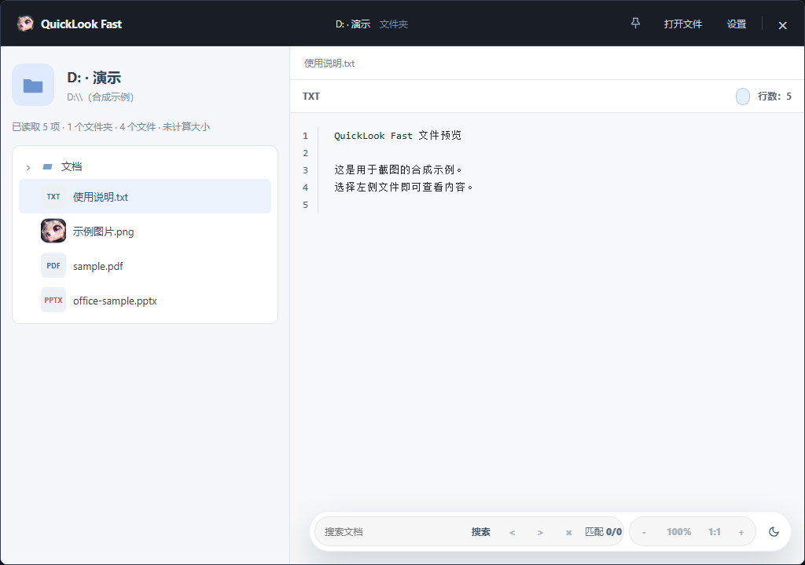
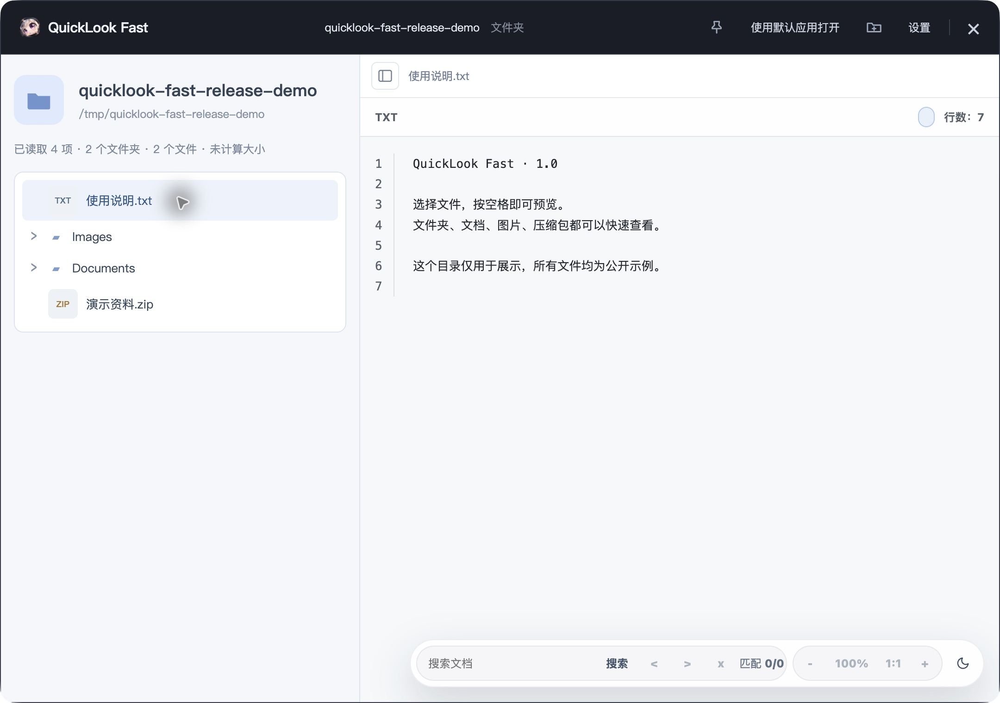
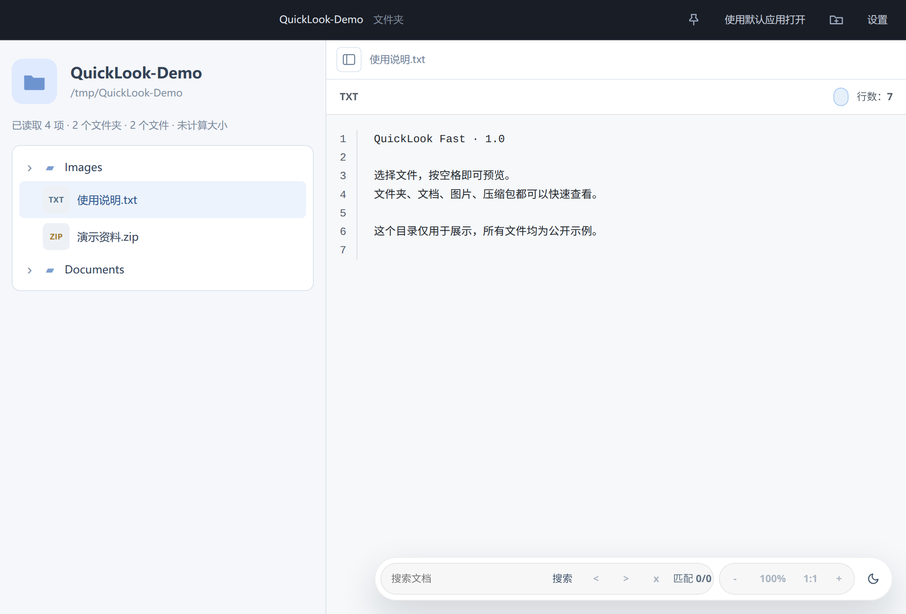
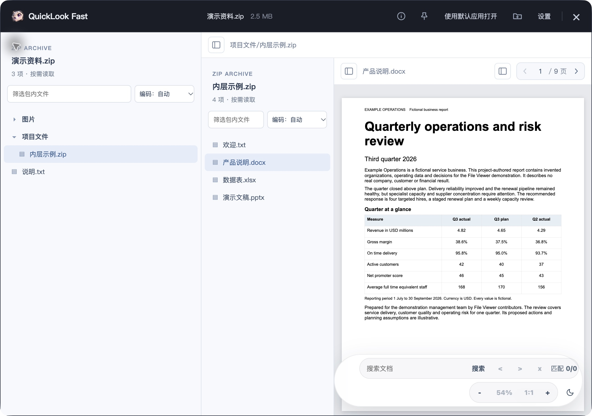
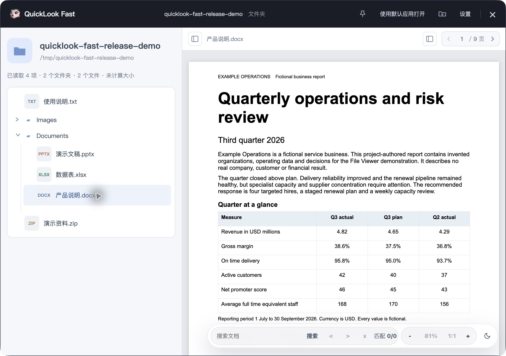
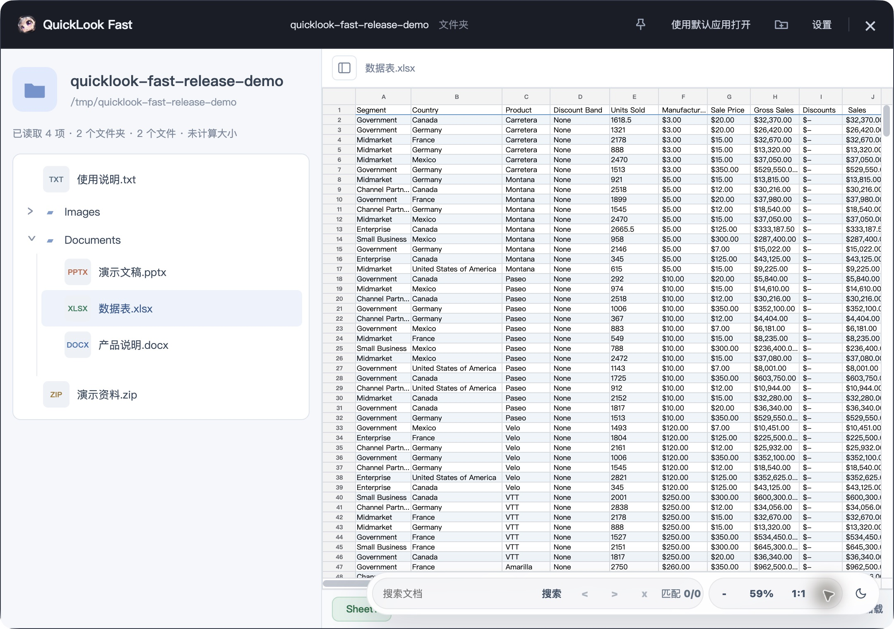
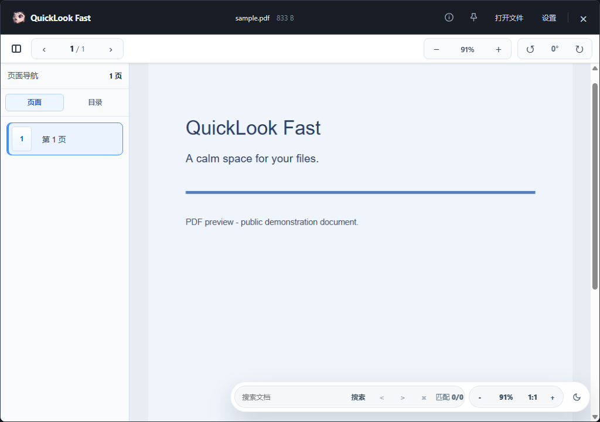

# 做了一个跨 Windows、macOS 和 Linux 的空格预览工具：QuickLook Fast 1.0

平时找文件时，我经常只是想确认一下：这个文件夹里有什么？这份文档是不是我要的版本？压缩包里面放了哪些东西？

每次都打开文件管理器，再启动对应的软件，看完再关掉，总觉得有点打断思路。我很喜欢 macOS Quick Look 和 Windows 上类似工具的用法：选中文件，按一下空格，看完再按一下，继续做手里的事。

所以我一直在做 **QuickLook Fast**。从 Windows 文件预览的使用场景出发，现在把它扩展到了 macOS 和 Linux。最近整理了一轮跨平台接入、文件夹预览和兼容性问题，今天正式发布 **1.0**。

项目地址：[Chaoleme-Studio/quick_look_fast](https://github.com/Chaoleme-Studio/quick_look_fast) 
下载地址：[GitHub Releases](https://github.com/Chaoleme-Studio/quick_look_fast/releases/tag/v1.0.0)

先上图。Windows 图由 Windows 上的 Electron 界面渲染，目录与文件内容是合成演示数据；macOS 图使用实际应用与演示文件；Linux 图是在 Ubuntu 的独立虚拟显示中由 Linux Electron 渲染，目录为合成演示数据。预览界面的基本思路一致，系统窗口样式和接入方式会有区别。

## 文件夹预览：三个系统上的效果

选中文件夹后按空格，可以直接看到目录树。点击左侧的文件，右侧会显示对应内容，找资料时不用反复打开和关闭窗口。

**Windows**

**macOS**

**Linux**

文件夹里的图片可以显示缩略图，目录侧栏和右侧的文件预览也可以按自己的习惯调整。

另外加了一个小设置：**设置 → 文件夹 → 隐藏 macOS 系统文件**。打开后，文件夹和 ZIP/RAR 预览列表会隐藏 `.DS_Store` 和 `__MACOSX`；关闭后可以重新显示。它只控制显示，不会删除这些文件。

## 压缩包：先看里面有什么

ZIP 和 RAR 可以先展开目录，再选中里面的文件查看。拿到一个资料包时，可以先判断内容是否需要，再决定下一步怎么处理。

如果 ZIP 里面还有一个 ZIP，也可以选中内层压缩包继续浏览，再预览里面的文件。下面这张图展示的是“外层 ZIP → 内层 ZIP → Word 文档”；嵌套深度、条目大小等有限制，详见[使用指南](https://github.com/Chaoleme-Studio/quick_look_fast/blob/v1.0.0/docs/user-guide.md)。

常见的密码 ZIP/RAR 会根据文件情况请求密码。不同压缩方式、分卷和加密组合的支持程度有区别，遇到无法读取的文件，欢迎带上可以公开的样本反馈。

## PPT、Word、Excel 和其他文件

不只是看文件名。常用的文档、表格、演示文稿、PDF、图片、音视频、代码和 Markdown 等，也可以直接进入对应预览。

**PowerPoint：**查看幻灯片，使用页码控件翻页或跳转。

**Word：**查看文档内容；使用了标题样式的文档可以显示章节导航。

**Excel：**先查看工作表和表格内容，确认需要的文件后，再用表格软件继续编辑。

**PDF：**查看页面内容。

当前预览链路接入了 200 多个扩展名，也包括一部分三维、设计和工程文件。这里说的是“会尝试对应的预览或结构查看”，不代表每个扩展名下的所有文件都已经逐一验证，也不代表复杂 Office 文档一定与原软件完全一致：字体、图片、动画、公式和特殊样式都可能影响效果。[完整格式清单](https://github.com/Chaoleme-Studio/quick_look_fast/blob/v1.0.0/docs/formats.md)里有更具体的说明。

## 三个平台分别怎么用

**Windows**：下载 Windows x64 便携包，完整解压后启动程序。在已接入的资源管理器入口选中文件，按空格打开或收起预览。

**macOS**：下载 Apple Silicon 版本，新安装默认使用 QuickLook Fast 的 Space 接管；在“设置 → 系统集成”也可以选择系统快速查看或 QuickLook Fast 的 `⌘⇧Space`。使用 Space 接管时需要按系统提示授权辅助功能，桌面文件可能还会触发桌面资料夹权限提示。Dock 和菜单栏图标可以分别控制显示。

**Linux**：下载与你的 Linux 系统架构匹配的包，完整解压后运行集成脚本。GNOME Files 可使用 `./install-integration.sh --gnome`。Dolphin 需要先运行 `./install-integration.sh` 安装菜单；Dolphin 26.04 及以上可在快捷键设置里把 QuickLook Fast 的菜单动作绑定到 Space，并处理它原来占用 Space 的选择模式。更早版本可使用右键菜单。

KDE Plasma 桌面的空格预览是可选的实验性接入，需要单独运行 `./install-integration.sh --plasma-desktop`；它和 Dolphin 内的快捷键是两回事。Linux 窗口现在会按可用屏幕区域设置初始大小，并使用系统边框来移动和缩放。

目前在 Ubuntu GNOME 虚拟桌面和 Fedora 45 ARM64、Plasma Wayland 虚拟机上做过接入测试；这些测试不能代替 Fedora 44 和其他桌面环境的实测。

Linux 桌面、发行版和文件管理器组合很多，建议先看一下[平台接入说明](https://github.com/Chaoleme-Studio/quick_look_fast/blob/v1.0.0/docs/platforms.md)。文档里写了 Dolphin 的具体配置、冲突处理、恢复和卸载方法。macOS 的发布包采用临时签名，Windows 包也未做发行者证书签名；系统版本和安装限制同样列在说明里。

## 这一版还做了什么

- 在支持选区跟随的文件管理器中，可用方向键切换文件；固定预览后，还可以继续查看其他文件。
- 默认情况下，即使刚点击过预览里的按钮或设置开关，再按 Space 也会收起预览；可以在设置里调整这个行为。
- Word 和 PPTX 有页码控件；Word 可以按标题样式显示文档导航。
- 图片可缩放和拖动查看，文件信息面板可显示已识别的尺寸及部分照片信息。
- 预览以本地处理为主；手动检查更新时会访问 GitHub。

目前 Dolphin 还不能在预览窗口里用方向键跟随切换文件；需要先收起预览，再在 Dolphin 里选择另一个文件。不同文件内容的还原效果、部分加密和特殊格式也还有继续改进的空间。

项目源码采用 Apache-2.0；第三方组件有各自的许可证，详情在[第三方说明](https://github.com/Chaoleme-Studio/quick_look_fast/blob/v1.0.0/THIRD_PARTY.md)。

如果你也经常在不同系统之间切换，希望它能帮你少做几次“打开—确认—关闭”。特别欢迎 Linux 用户帮忙试试不同桌面和文件管理器：遇到快捷键冲突、某个格式显示异常，或者有更顺手的交互建议，都欢迎到 [GitHub Issues](https://github.com/Chaoleme-Studio/quick_look_fast/issues) 留言。
