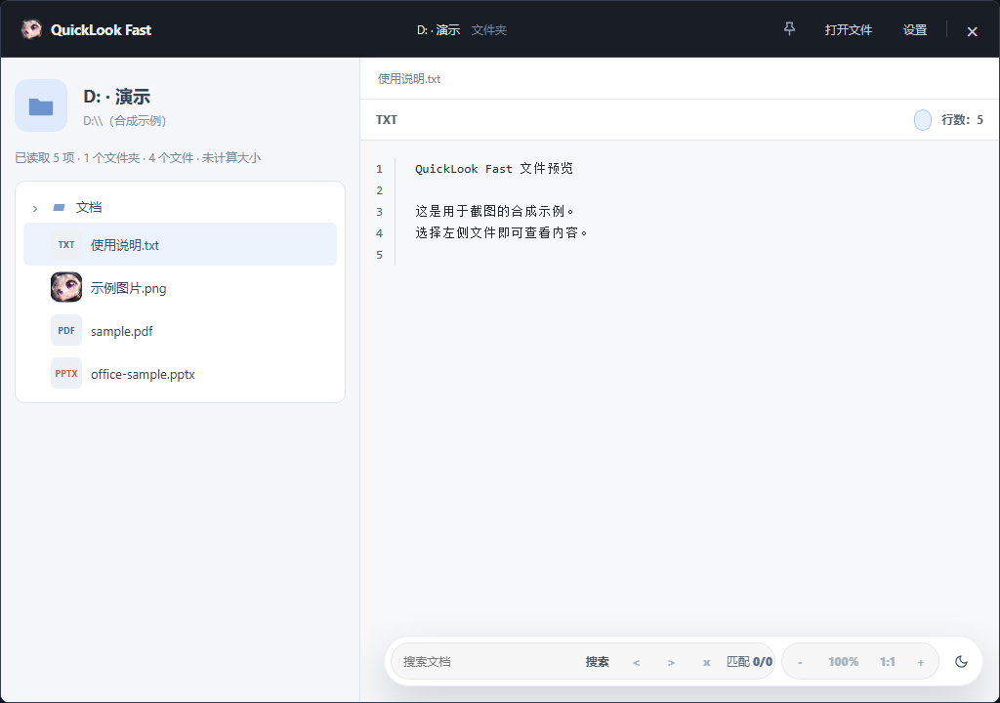
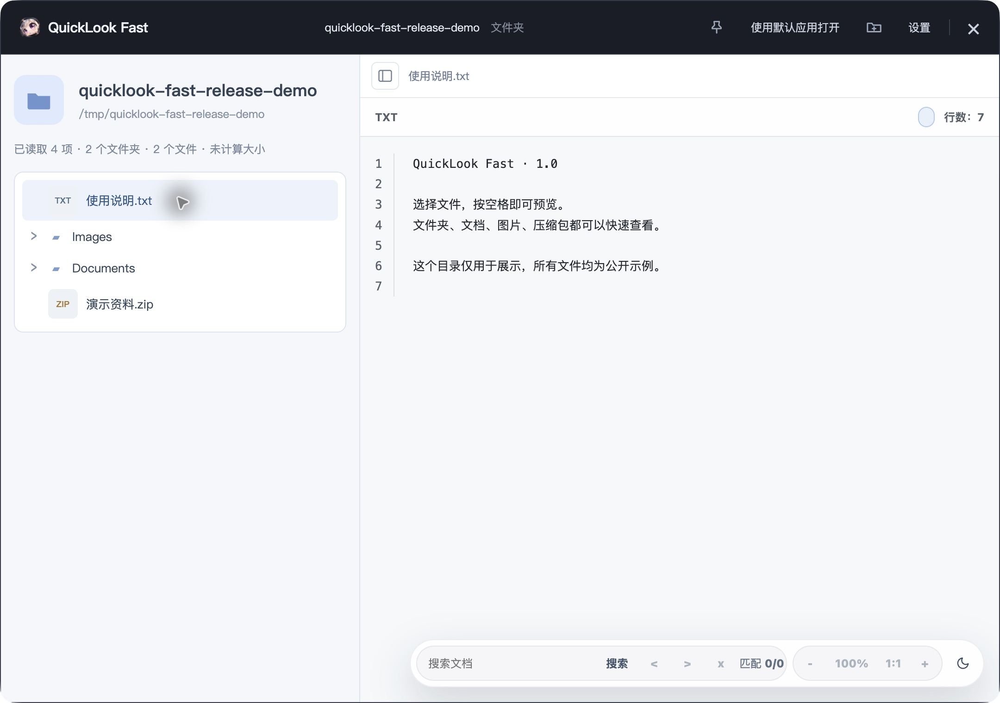
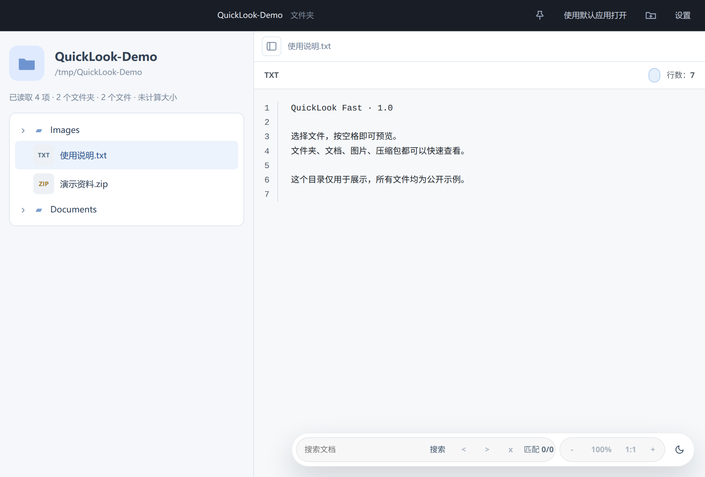
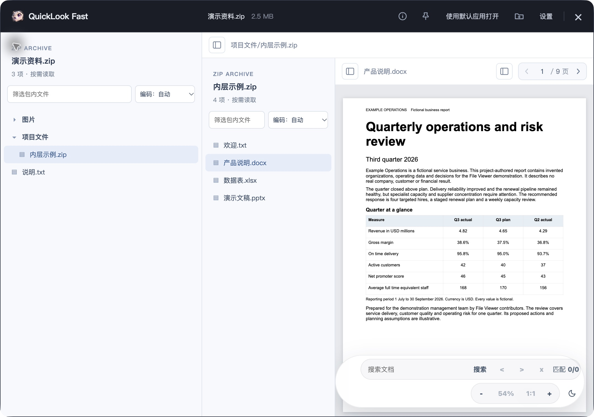
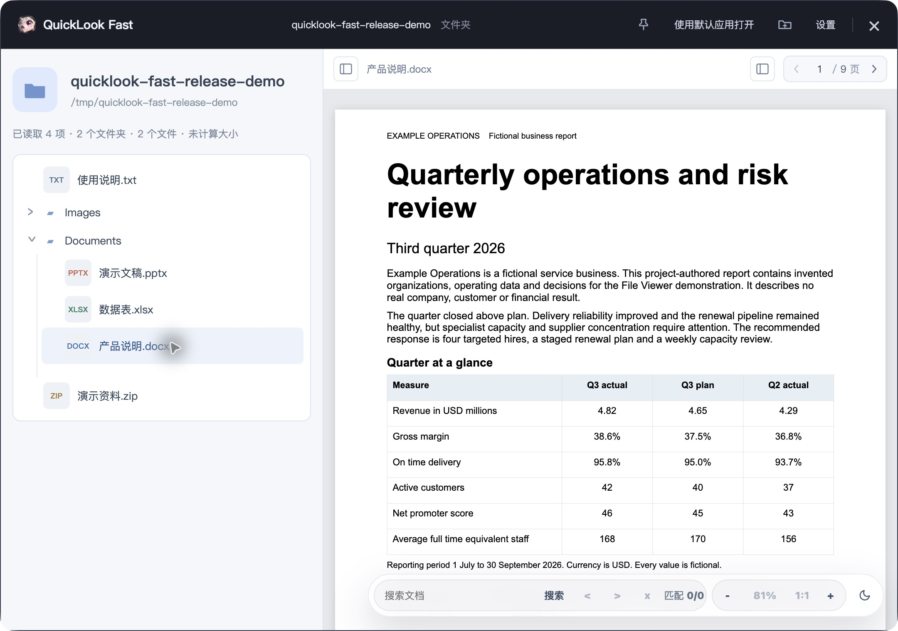
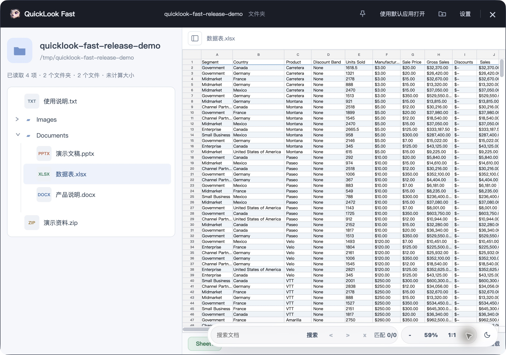

# QuickLook Fast 1.0 多平台发布文案

项目地址：<https://github.com/Chaoleme-Studio/quick_look_fast> 
下载地址：<https://github.com/Chaoleme-Studio/quick_look_fast/releases/tag/v1.0.0>

Linux DO 可直接使用 [配图长文](linux-do-1.0.md)。下面是其他平台的标题、正文和配图顺序；图片均位于仓库 `docs/screenshots/` 中，按对应平台的上传方式添加即可。

---

## 知乎

**标题：做了一个跨 Windows、macOS 和 Linux 的空格预览工具，分享一下 1.0**

找文件的时候，我经常只是想快速确认一下内容：这个文件夹里有哪些资料，这份 PPT 是不是要找的版本，压缩包里有没有我需要的文档。

macOS 的 Quick Look 和 Windows 上类似的工具，把这件事变得很顺手：选中文件、按空格，看完再按空格收起。我想把这种操作习惯带到不同系统上，所以做了 QuickLook Fast，现在整理到了 1.0。

### 同样是预览文件夹，三个系统都能用

选中文件夹后按空格，左侧可以浏览目录，点击文件后右侧显示内容。Windows、macOS 和 Linux 使用相近的预览界面，但接入文件管理器的方式各有不同。Windows 图由 Electron 界面渲染，目录和文件内容为合成演示数据；macOS 图使用实际应用与演示文件；Linux 图在 Ubuntu 虚拟显示中渲染，目录为合成演示数据。

文件夹中可以按需显示图片缩略图。设置里还加了隐藏 `.DS_Store` 和 `__MACOSX` 的开关，在文件夹和 ZIP/RAR 预览中生效；只是从列表隐藏，文件本身不会被删除。

### 压缩包和常用办公文件

对于 ZIP 和 RAR，可以先浏览目录，再选择里面的文件预览。遇到常见的密码压缩包，会根据情况请求输入密码；具体支持与压缩方式和文件本身有关。

ZIP 里如果还有 ZIP，也可以选中内层压缩包继续浏览，再预览里面的文件。下面的截图依次显示了外层 ZIP、内层 ZIP 和其中的 Word 文档；嵌套深度与条目大小有限制。

PPTX 可以查看幻灯片并使用页码跳转；Word 可以查看内容，并根据标题样式生成章节导航；Excel 可以先查看工作表。PDF、图片、音视频、代码、Markdown，以及部分设计、工程和三维格式也接入了预览链路。

目前接入了 200 多个扩展名。这个数字是预览链路的覆盖范围，不代表每种文件都已完整验证；复杂的字体、公式、图表、动画和文档排版，仍可能与原软件显示不同。

### 跨平台接入时遇到的一些细节

macOS 有系统自带的快速查看。QuickLook Fast 提供系统快速查看、Space 接管和 `⌘⇧Space` 三种选择；接管 Space 需要辅助功能权限。Dock 图标和菜单栏图标可以分别显示或隐藏。

Linux 的情况更分散：GNOME Files 使用预览服务；Dolphin 需要安装服务菜单，Dolphin 26.04 及以上可为菜单设置快捷键；KDE Plasma 的桌面入口则是单独的实验性组件。Dolphin 原本的 Space 选择模式可能与预览冲突，配置和恢复步骤都写在了[平台说明](https://github.com/Chaoleme-Studio/quick_look_fast/blob/v1.0.0/docs/platforms.md)里。

Linux 预览窗口也调整为按可用屏幕设置初始大小，并使用系统原生边框，便于移动和调整大小。目前 Dolphin 不能在预览窗口里用方向键跟随选区切换，需要先收起预览再选择另一个文件。

项目以本地预览为主，源码和使用说明在 GitHub：

项目：<https://github.com/Chaoleme-Studio/quick_look_fast> 
下载：<https://github.com/Chaoleme-Studio/quick_look_fast/releases/tag/v1.0.0>

欢迎试用，也欢迎反馈不同文件管理器、桌面环境和文件格式下遇到的问题。对于显示异常，如果方便的话，附一个可以公开的示例文件会很有帮助。

---

## B 站

**标题：做了一个跨 Windows、macOS、Linux 的空格预览工具｜QuickLook Fast 1.0**

**简介：**

找文件时，只想先看一眼，不一定需要立刻打开对应的软件。

我做了 QuickLook Fast：选中文件或文件夹，按空格打开预览，看完再按空格收起。现在 Windows、macOS 和 Linux 都有对应的接入方式。

视频里会展示：

1. 三个系统上的文件夹预览和内容查看。
2. ZIP / RAR 目录与包内文件预览，以及 ZIP 里面嵌套 ZIP 的查看方式。
3. PPT、Word、Excel、PDF 和其他格式的预览。
4. macOS 的图标设置，以及 Linux 上的快捷键接入。

Linux 的 Dolphin 需要先安装菜单并自行设置 Space；KDE Plasma 桌面接入是实验性的。格式覆盖不等于所有文件都能完整还原，复杂文档可能和原软件显示不同。

截图说明：Windows 图使用合成目录和文件数据；Linux 图为 Ubuntu 虚拟显示中的 Electron 界面，目录为合成演示数据。

项目：<https://github.com/Chaoleme-Studio/quick_look_fast> 
下载：<https://github.com/Chaoleme-Studio/quick_look_fast/releases/tag/v1.0.0>

欢迎在评论区说说你使用的系统、文件管理器和希望支持的格式。

**建议标签：**开源软件 / 效率工具 / 文件预览 / Linux / macOS / Windows

**封面文案：**三个系统，空格看文件 
**画面顺序：**`folder.png` → `macos-folder.png` → `linux-folder.png` → `archive-nested.png` → `pptx.png` → `word.png` → `excel.png`

---

## 小红书

**标题：找文件不用反复打开了！我做了个跨平台空格预览工具**

**正文：**

文件一多，找资料就很容易变成：打开文件 → 不是这个 → 关掉 → 再打开下一个……

我做了一个小工具 **QuickLook Fast**，现在更新到 1.0 了。

选中文件或者文件夹，按一下空格就能看内容；看完再按一次，继续找下一个。

这次整理了几个我自己很常用的场景：

📂 文件夹：左边看目录，右边直接预览选中的文件。

📦 压缩包：先看看 ZIP / RAR 里面有什么；ZIP 里还有 ZIP，也能继续看内层内容。

📊 办公文件：PPT、Word、Excel 和 PDF 都可以先预览。

🖥️ 跨平台：Windows、macOS、Linux 都有对应的接入方式。

macOS 还可以调整 Dock 和菜单栏图标；Linux 的 Dolphin 要先配置快捷键。不同格式的还原效果会因文件而异，复杂文件建议用原软件再确认。

图片使用演示数据；Linux 图是在 Ubuntu 虚拟显示中渲染的应用窗口。

项目地址：github.com/Chaoleme-Studio/quick_look_fast

你平时最希望快速预览什么格式？

#效率工具 #开源软件 #文件预览 #电脑技巧 #Mac应用 #Linux #Windows

**封面文字：**找文件，按一下空格就够了 
**图卡顺序：**

1. Windows 文件夹：`folder.png`，配字“选中文件夹，空格预览”。
2. macOS 文件夹：`macos-folder.png`，配字“macOS 也能这样看”。
3. Linux 文件夹：`linux-folder.png`，配字“Linux 同样能用”。
4. 压缩包：`archive-nested.png`，配字“ZIP 里还有 ZIP，也能继续看”。
5. 演示文稿：`pptx.png`，配字“PPT 先看一眼”。
6. 文档：`word.png`，配字“Word 文档和分页预览”。
7. 表格：`excel.png`，配字“Excel 先看工作表”。
8. PDF：`pdf.png`，配字“确认文件，再决定要不要打开”。

---

## 抖音

**标题：我做了个小工具：选中文件，按空格就能预览**

**视频简介：**

找文件的时候，不用每个都打开试一遍。QuickLook Fast 1.0 支持 Windows、macOS 和 Linux 的文件预览。PPT、Word、Excel、PDF、文件夹和压缩包都能先看一眼；ZIP 里套 ZIP，也可以继续浏览。Linux 的部分文件管理器需要先配置快捷键；复杂文件的显示效果可能不同。

项目：github.com/Chaoleme-Studio/quick_look_fast

#电脑技巧 #效率工具 #开源软件 #文件预览 #Linux #Mac

**封面文字：**选中文件，按空格 
**副标题：**Windows / macOS / Linux

**约 35 秒口播与字幕：**

| 画面 | 口播 / 字幕 |
| --- | --- |
| `folder.png`：文件夹列表和右侧内容 | 找文件的时候，你是不是也经常打开一个、关掉，再打开下一个？ |
| `macos-folder.png`、`linux-folder.png`：两张图依次切换 | 我做了一个空格预览工具，Windows、macOS 和 Linux 都有对应版本。 |
| 三张文件夹图依次展示 | 选中文件夹按空格，左边看目录，右边就能看选中的文件。 |
| `archive-nested.png`：外层 ZIP、内层 ZIP 和 Word | 压缩包里还有一个 ZIP？点进去，还可以继续看里面的文件。 |
| `pptx.png`、`word.png`、`excel.png` | PPT、Word、Excel、PDF，找到需要的文件再用原软件打开。 |
| `settings.png` 或项目地址画面 | 项目叫 QuickLook Fast，已经开源。你还想预览什么格式？ |

口播时可在 Linux 画面下加字幕：“Ubuntu 虚拟显示渲染，演示目录；Dolphin 需先配置快捷键；KDE 桌面入口为实验性功能。”Windows 截图也使用合成目录和文件数据。
